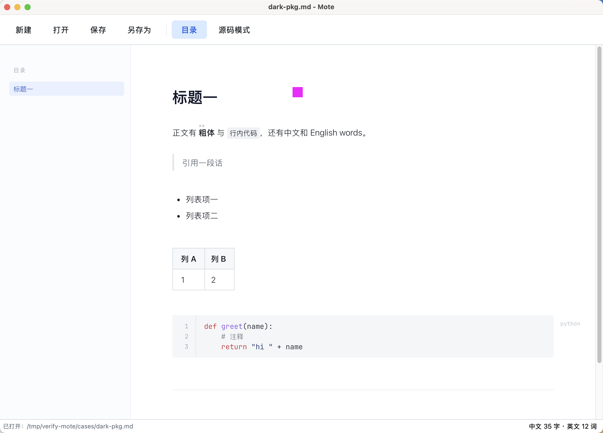
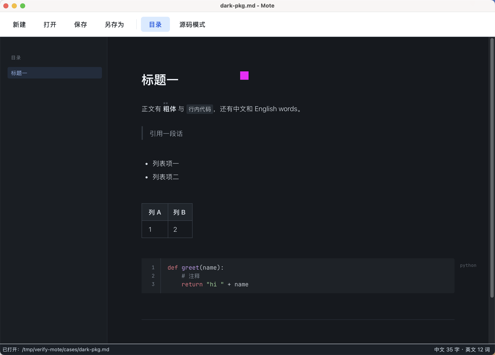
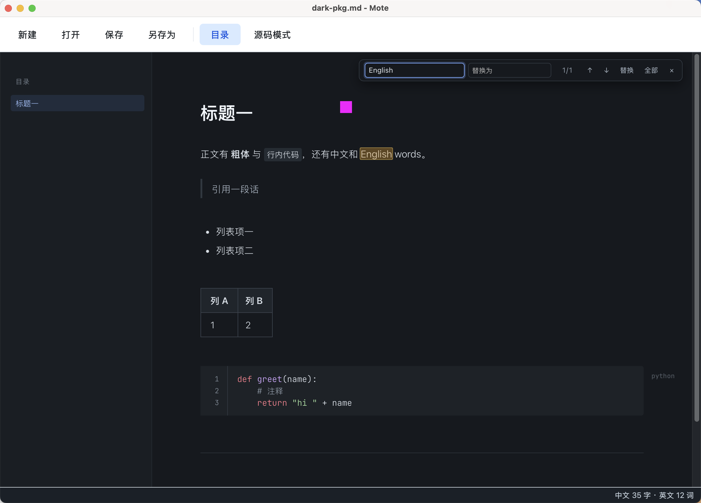
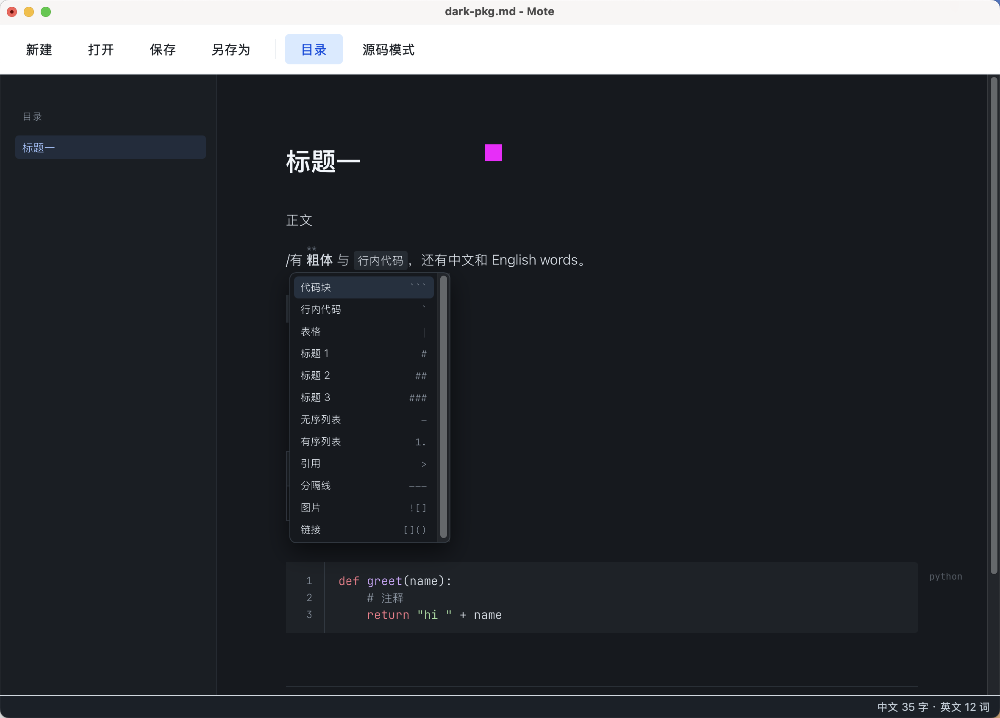
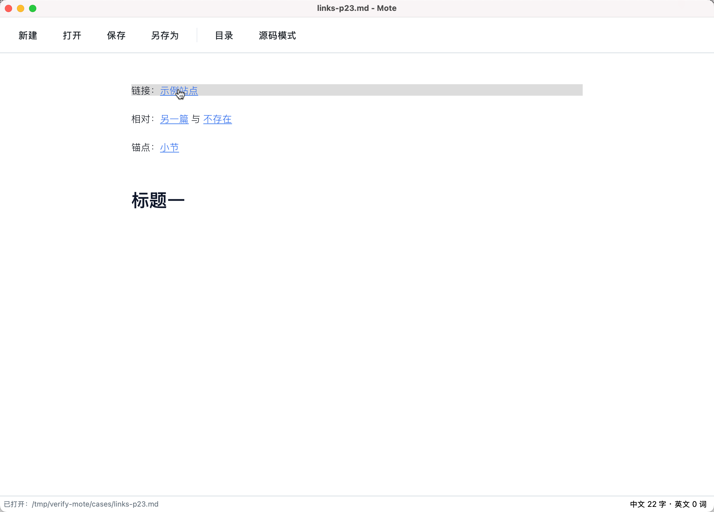
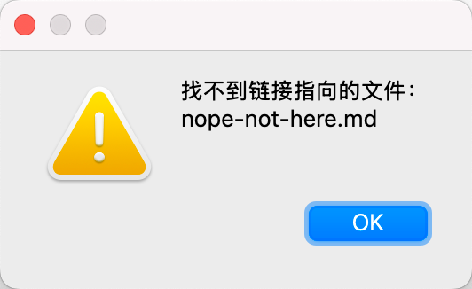
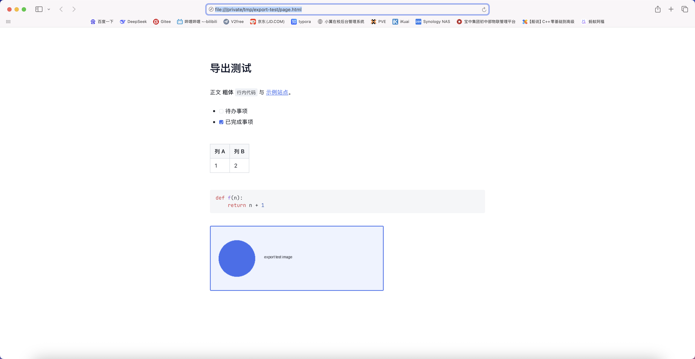

# Mote 用户手册

> **Mote v1.0.0** · macOS / Windows 双平台 · 最后更新 2026-11-17
> C++20 原生薄外壳 + 系统 WebView 的 Markdown 查看 / 编辑器。macOS 用 AppKit + WKWebView，Windows 用 Win32 + WebView2。前端零框架、零构建，不含 Electron 运行时。

---

## 目录

1. [快速开始](#1-快速开始)
2. [界面概览](#2-界面概览)
3. [所见即所得块编辑](#3-所见即所得块编辑)
4. [代码块](#4-代码块)
5. [表格](#5-表格)
6. [查找替换](#6-查找替换)
7. [目录导航](#7-目录导航)
8. [图片](#8-图片)
9. [斜杠命令](#9-斜杠命令)
10. [深色模式](#10-深色模式)
11. [缩放与字体](#11-缩放与字体)
12. [源码模式](#12-源码模式)
13. [链接](#13-链接)
14. [块类型转换](#14-块类型转换)
15. [任务列表](#15-任务列表)
16. [导出 HTML 与 PDF](#16-导出-html-与-pdf)
17. [快捷键速查](#17-快捷键速查)
18. [在线更新](#18-在线更新)
19. [常见问题](#19-常见问题)

---

## 1. 快速开始

### 1.1 下载安装

从官方下载页获取最新版本：

- **macOS**：macOS 14+ · Apple Silicon（M 系列）· [下载 .dmg](https://dl.xiaotu.online/mote/Mote-macOS-native-1.0.0.dmg)
- **Windows**：Windows 10/11 · 64 位 · 下载安装包（setup.exe）或绿色版（zip）

macOS 首次打开时，Gatekeeper 可能会提示"无法验证开发者"：在「系统设置 → 隐私与安全性」点「仍要打开」即可。DMG 内 .app 已通过 Apple 公证，spctl 检查为 `Notarized Developer ID`。

### 1.2 首个文档

打开 Mote 后，默认展示一份空白文档。按 `Cmd+N`（Windows：`Ctrl+N`）新建，按 `Cmd+S`（Windows：`Ctrl+S`）保存为 `.md` 文件即可开始写作。

---

## 2. 界面概览

Mote 的窗口分为三个区域：

- **标题栏 / 菜单栏**：macOS 位于屏幕顶部；Windows 与窗口融合
- **正文区域**：所见即所得的 Markdown 编辑 / 渲染区
- **目录栏**（可选）：由文档内标题自动生成，点击跳转

| macOS 菜单 | Windows 菜单 |
|------------|--------------|
| `Mote → 检查更新…` | `文件 → 检查更新…` |
| `文件 → 新建 / 打开 / 保存 / 导出…` | `文件 → 新建 / 打开 / 保存 / 导出…` |
| `编辑 → 查找…` | `编辑 → 查找…` |
| `视图 → 深色模式 / 缩放 / 目录` | `视图 → 深色模式 / 缩放 / 目录` |


---

## 3. 所见即所得块编辑

Mote 按空行把文档切成**块**（paragraph block），这是整个编辑体验的核心。

### 3.1 什么是"块"

- 一段正文、一个标题、一行列表项、一个代码围栏、一个表格——各自构成一个块
- 相邻块之间必须有**至少一个空行**分隔，否则被视为同一块的延续

### 3.2 点击即编辑

- 在渲染态下点击任意块，该块切换为 Markdown 原文输入态，其余块保持排版效果
- 离开该块（点击别处、按 `Esc` 或切换应用）后，按原文重新渲染


### 3.3 缩放与内联标记

窗口较窄时，标题的 `#`、粗体的 `**`、链接的 `[]()` 等标记会以淡色内联方式显示，方便定位但不破坏排版。


放大后标记隐藏：


---

## 4. 代码块

### 4.1 围栏代码块

Markdown 三反引号围栏创建代码块，支持语法高亮（内置轻量高亮，无第三方解析库）：

```markdown
```python
def hello():
    print("Hello, Mote")
```
```


点击块右上角的**语言徽标**可切换语言：


切换后语言徽标更新：


### 4.2 行号与选择

代码块左侧显示行号，支持跨行选择。选中文本时字体自动加粗，便于区分编辑态与选区：


行号 100、121、260 处都已验证行号与实际行数对齐：


---

## 5. 表格

### 5.1 三种创建方式

| 方式 | 操作 | 效果 |
|------|------|------|
| 管道分隔 | `\| 列1 \| 列2 \|` | 标准 Markdown 表格 |
| `Cmd+Enter` | 在空行按快捷键 | 插入 2×2 空表 |
| 右键 → 转为表格 | 选中多行后右键 | 将选中内容转为表格 |

### 5.2 就地编辑

点击表格进入编辑态，单元格光标可以在单元格间切换：


点击后进入编辑：


`Cmd+Enter` 方式插入空表：


### 5.3 表格转义

当单元格内容本身包含管道符 `|` 时，用反斜杠转义：`\|`：


---

## 6. 查找替换

按 `Cmd+F`（Windows：`Ctrl+F`）打开查找条，支持跨块跳转。

### 6.1 基本查找

打开查找条 → 输入关键词 → `Enter` 向下 / `Shift+Enter` 向上跳转：


关闭查找条，原焦点块恢复：


### 6.2 高级：替换与保护边界

- **跨块跳转**：一个命中不会跨越块边界
- **安全替换**：不会替换标记里的 `|`、代码围栏里的 ` ``` ` 等特殊结构
- **拒绝危险替换**：跨标记、含换行、表格里的 `|`、代码里的 ``` 等替换会被拒绝并在查找条说明原因


安全替换后原文更新：


---

## 7. 目录导航

### 7.1 显示目录

按 `Cmd+Shift+L` 开关目录栏。目录由文档内各级标题（`#` ~ `###`）自动生成：


### 7.2 三种光标形态

鼠标在目录栏不同位置会显示对应光标，避免在目录上移动时光标闪烁：

| 位置 | 光标 |
|------|------|
| 条目文字行 | 手型（可点击跳转） |
| 行间空隙 | 手型 |
| 栏内空白 | 手型 |
| 折叠按钮 | 默认指针 |
| 滚动条 | 默认指针 |


---

## 8. 图片

粘贴剪贴板图片，或直接把图片拖入窗口——Mote 会把图片落盘到当前 Markdown 同目录的 `assets/` 文件夹，并自动插入相对路径。

### 8.1 三种来源

| 操作 | 结果 |
|------|------|
| `Cmd+V` 粘贴 | 图片 → `assets/xxx.png`，自动插入 `` |
| 拖入 PNG/JPG | 同上 |
| 手动写 Markdown | `` |


---

## 9. 斜杠命令

在空行输入 `/`，会弹出斜杠命令菜单，快速把当前块转为指定类型：

```
/
```


选择「标题 1」：


### 9.1 可用命令

| 命令 | 功能 |
|------|------|
| `/h1` `/h2` `/h3` | 标题 1–3 |
| `/p` | 正文段落 |
| `/ul` `/ol` | 无序 / 有序列表 |
| `/quote` | 引用 |
| `/code` | 代码块 |
| `/table` | 插入表格 |
| `/task` | 任务列表（`- [ ]`） |

---

## 10. 深色模式

默认跟随系统外观，也可以手动切换。切换只换配色，不改文档内容。

| 操作 | 效果 |
|------|------|
| `视图 → 深色模式` | 手动开深色 |
| `视图 → 浅色模式` | 手动开浅色 |
| `视图 → 跟随系统外观` | 交回系统 |





深色模式下打开查找条：



深色模式 + 斜杠命令：



---

## 11. 缩放与字体

| 快捷键 | 效果 |
|--------|------|
| `Cmd+=`（Windows：`Ctrl+=`） | 放大一级 |
| `Cmd+-`（Windows：`Ctrl+-`） | 缩小一级 |
| `Cmd+0`（Windows：`Ctrl+0`） | 重置为默认 100% |

缩放级别 100% / 121% / 260%：


### 11.1 排版

正文与代码块采用不同字重，层次分明：


代码块正文使用更轻的字重，围栏标签使用常规字重，便于区分：


代码块行间距已优化，长代码阅读更舒适：


---

## 12. 源码模式

按 `Cmd+E`（Windows：`Ctrl+E`）在渲染态与纯文本 Markdown 之间切换。源码模式下看到的就是磁盘上的 `.md` 原文，可以做全局搜索、批量替换等操作。


---

## 13. 链接

| 场景 | 行为 |
|------|------|
| 渲染态下普通点击 `[文字](url)` | 进入该块编辑态（与普通块一致） |
| 渲染态下 `Cmd+Click`（Windows：`Ctrl+Click`） | 外部链接用系统默认浏览器打开；相对路径 `.md` 在应用内打开（走未保存确认） |
| 编辑态下 | 显示原始 `[文字](url)` 标记 |

链接文字为蓝色带下划线。`Cmd+Click` 悬停时可看到锚点跳转状态：



锚点跳转状态提示：


链接目标不存在时弹提示：



---

## 14. 块类型转换

右键任意块弹出「转为」菜单，支持正文、标题 1–3、无序/有序列表、引用、代码块、表格、任务列表之间互转：


选择「标题 1」：


选择「代码块」：


### 14.1 选中多选合并

选中多个相邻块（在编辑态下选中多行 Markdown）后右键「转为 → 列表」，可以把多行合并成一个列表：


撤销操作恢复原状：


---

## 15. 任务列表

Markdown 标准语法：

```markdown
- [ ] 待办事项
- [x] 已完成事项
* [ ] 星号列表项同样支持
+ [x] 加号列表项同样支持
```

渲染成可点击复选框。点击即改写原文的 `[ ]` ／ `[x]`，一次撤销可还原。

---

## 16. 导出 HTML 与 PDF

| 操作 | 格式 | 快捷键 |
|------|------|--------|
| `文件 → 导出 HTML…` | 单文件自包含 HTML（样式内联、图片 base64 内嵌、代码高亮保留） | `Option+Cmd+E` |
| `文件 → 导出 PDF…` | A4 多页、无页眉页脚 | `Cmd+P` |

源码模式下禁用 PDF 导出。两端分页切点由各自 WebView 引擎决定，未做逐页像素比对。

导出的 HTML 用浏览器打开：



---

## 17. 快捷键速查

### 通用

| 功能 | macOS | Windows |
|------|-------|---------|
| 新建 | `Cmd+N` | `Ctrl+N` |
| 打开 | `Cmd+O` | `Ctrl+O` |
| 保存 | `Cmd+S` | `Ctrl+S` |
| 查找 | `Cmd+F` | `Ctrl+F` |
| 源码模式 | `Cmd+E` | `Ctrl+E` |
| 切换深色 | `Cmd+Shift+D` | `Ctrl+Shift+D` |
| 开关目录 | `Cmd+Shift+L` | `Ctrl+Shift+L` |
| 放大 | `Cmd+=` | `Ctrl+=` |
| 缩小 | `Cmd+-` | `Ctrl+-` |
| 重置缩放 | `Cmd+0` | `Ctrl+0` |
| 导出 HTML | `Option+Cmd+E` | `Alt+Ctrl+E` |
| 导出 PDF | `Cmd+P` | `Ctrl+P` |
| 检查更新 | 菜单：`Mote → 检查更新…` | 菜单：`文件 → 检查更新…` |

### 编辑

| 功能 | macOS | Windows |
|------|-------|---------|
| 插入表格 | `Cmd+Enter` | `Ctrl+Enter` |
| 离开编辑块 | `Esc` | `Esc` |

---

## 18. 在线更新

### 18.1 自动检查

启动 10 秒后自动检查一次，之后每 24 小时检查一次。

### 18.2 手动检查

- **macOS**：菜单 `Mote → 检查更新…`
- **Windows**：菜单 `文件 → 检查更新…`

### 18.3 更新方式

| 平台 | 机制 | 签名验证 | 安装方式 |
|------|------|----------|----------|
| macOS | Sparkle 2 | EdDSA 公钥内置于 Info.plist | 下载 DMG → 替换 .app → 重启 |
| Windows（安装版） | 应用内下载 | SHA256 校验 | 静默安装 → 自动重启 |
| Windows（绿色版） | 应用内下载 | SHA256 校验 | 打开所在文件夹 → 解压覆盖 |

### 18.4 macOS 隔离路径提示

如果 Mote 是首次从 DMG 拖出、带 quarantine 标记启动的，Gatekeeper 会把它放在只读隔离路径（`AppTranslocation/.../`）。此时 Mote 在检查到更新后会先提示：

> **需要先移动到"应用程序"**
> 请退出 Mote，把它拖到「应用程序」文件夹，重新打开后再检查更新。

把 Mote 拖进 `/Applications` 后重启，再次检查更新即可正常升级。

---

## 19. 常见问题

### Q：macOS 首次打开提示"无法验证开发者"？

Mote 已通过 Apple 公证（Notarized Developer ID）。macOS 14+ 在 Gatekeeper 正确识别公证签名时应直接打开。如果出现提示：「系统设置 → 隐私与安全性」滚动到底部，点击「仍要打开」。

### Q：更新进度很慢 / 失败？

- 检查网络：更新包托管在阿里云 OSS（`oss-cn-hongkong`），走 `dl.xiaotu.online` CDN
- macOS 用户如果看到 Sparkle 自动重启后失败，通常是隔离路径（App Translocation）问题——把 Mote 拖进「应用程序」后重试

### Q：Windows 绿色版怎么更新？

绿色版不支持静默替换。更新检查完成、SHA256 校验通过后，Mote 会自动打开下载目录并退出。手动解压 zip，把新 .exe 覆盖旧的即可。

### Q：为什么表格里的 `|` 会拒绝替换？

`|` 是表格结构标记，替换它会破坏表格结构。Mote 会主动拦截这类危险操作，并在查找条上说明原因。用转义符 `\|` 在表格里写入管道符。

### Q：图片存在哪里？

粘贴或拖入的图片会被保存到 **当前 Markdown 同目录的 `assets/` 文件夹**，Markdown 里用相对路径引用。移动 `.md` 文件时要一起移动 `assets/`。

### Q：Mote 会收集我的数据吗？

不会。Mote 不联网（除了自动更新检查 `dl.xiaotu.online` 和点击外部链接），所有文档和图片都保存在你本地磁盘。

---

**Mote · v1.0.0 用户手册 · © 2026**
